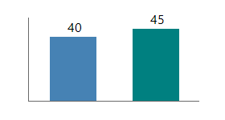

# 离线刷题样卷

## 7 · 资料分析 · 单选
阅读共用材料。2025 年甲区借阅量比 2024 年增加多少册？

![[材料/借阅统计]]

- A. 20 册
- B. 30 册
- C. 40 册
答案：A
解析：甲区增加 60 − 40 = 20 册。

## 12 · 资料分析 · 多选
![[材料/借阅统计]]

根据 2025 年数据，哪些说法正确？

- A. 甲区借阅量高于乙区。
- B. 乙区借阅量是 50 册。
- C. 下图的柱高能表示 2025 年两区借阅量（左甲，右乙）。

  
答案：AB
解析：甲区为 60 册，乙区为 50 册。选项 C 的图展示的是 2024 年，左柱低于右柱。

![[材料/借阅柱图.png]]

## 19 · 判断推理 · 判断
如果每个读者至少借阅一本书，那么读者人数不会多于借阅总册数。

- T. 正确
- F. 错误
答案：T
解析：每个读者至少贡献一册借阅量。
